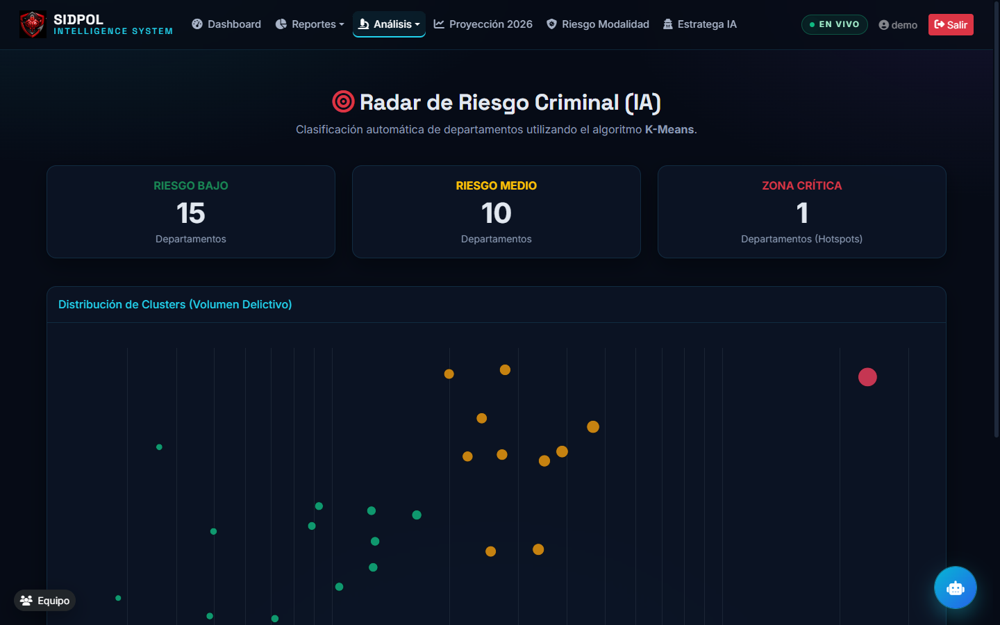
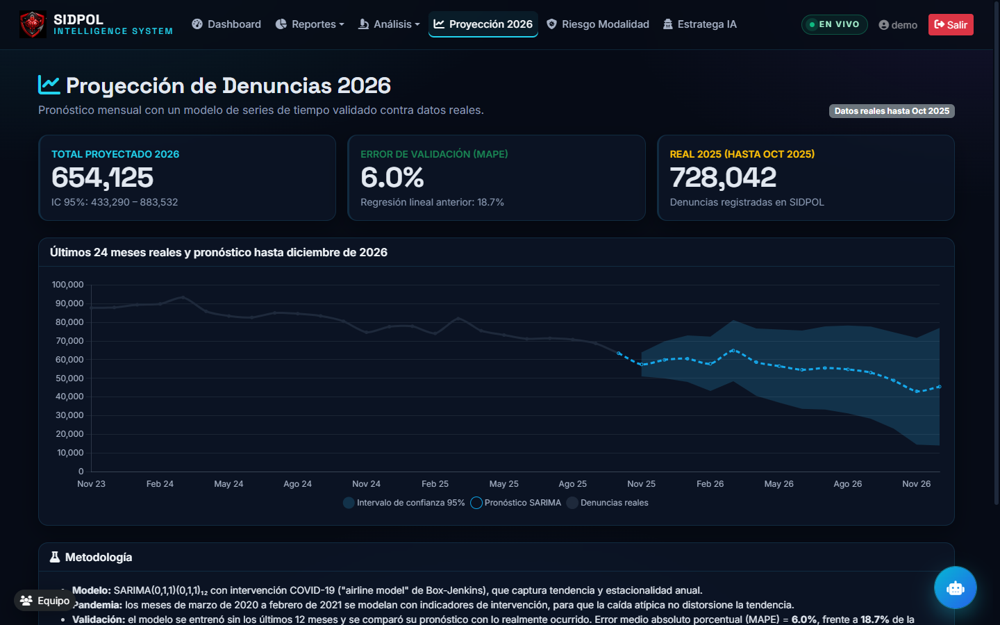

# SIDPOL: Análisis y proyección delictiva en el Perú con Machine Learning e IA generativa

[](https://github.com/Rihuall-star/sidpol-backend/actions/workflows/ci.yml)

Plataforma web de inteligencia de datos sobre las **denuncias policiales del Perú (SIDPOL, enero 2018 – octubre 2025, más de 337,000 registros)**. Combina analítica descriptiva, machine learning y un asistente de IA generativa que responde preguntas en lenguaje natural consultando la base de datos.

> Proyecto académico: curso *Tecnologías Emergentes en Inteligencia Artificial*, Maestría en Ingeniería de Sistemas e Informática, Universidad Nacional Mayor de San Marcos (2025).

**🔗 Demo:** https://sidpol-proyecto.onrender.com
**Usuario:** `demo` · **Contraseña:** `SidpolDemo2026`

> Cuenta de solo lectura con un límite diario de consultas a la IA. El servidor gratuito puede tardar unos 30 segundos en despertar la primera vez.


| Dashboard | Radar de riesgo (K-Means) | Proyección 2026 |
|---|---|---|
|  |  |  |

---

## ✨ Funcionalidades

| Módulo | Qué hace |
|---|---|
| **ETL y calidad de datos** | Normaliza los nombres de los 25 departamentos, agrega trimestres y corrige el conteo de denuncias (suma el campo `cantidad` en lugar de contar filas). |
| **Clustering K-Means** | Agrupa los departamentos por perfil de incidencia por modalidad (en porcentajes, para que el tamaño de Lima no sesgue el resultado) en 3 niveles de riesgo: bajo, medio y crítico. |
| **Análisis trimestral** | Compara la evolución de extorsión y homicidio en departamentos clave con el *Aggregation Framework* de MongoDB. |
| **Análisis regional y per cápita** | Distribución por Costa, Sierra y Selva, y tasas ajustadas por población. |
| **Proyección 2026** | Modelo **SARIMA(0,1,1)(0,1,1)₁₂** con intervención COVID-19, validado con los últimos 12 meses reales (**MAPE 6.0%** frente a 18.7% de la regresión lineal anterior) e intervalos de confianza por simulación. |
| **Asistente RAG (Gemini)** | Chat que consulta MongoDB antes de responder, para que la respuesta se base en los datos y no en el conocimiento general del modelo. |
| **Agentes** | Un *agente estratégico* genera planes de acción a partir de la proyección y un *agente logístico* asigna recursos según los clusters. |
| **Mapas de calor** | Visualización geoespacial de las zonas críticas (Highcharts Maps). |
| **Autenticación y roles** | Login con Flask-Login, contraseñas con hash (Werkzeug), rutas de administración y auditoría protegidas por rol, y límite diario de consultas a la IA para la cuenta demo. |

## 📊 Hallazgos principales
- **Cambio de tendencia:** las denuncias alcanzaron su máximo en 2023 (1,042,703) y vienen bajando desde mediados de 2024. El modelo SARIMA proyecta **~654 mil denuncias en 2026** (IC 95%: 433k – 884k); la regresión lineal anterior proyectaba más de 1 millón porque ignoraba ese cambio.
- **Extorsión:** pasó de 4,734 denuncias en 2021 a 22,356 en 2024 (**+372%**) y sigue creciendo en 2025 (+27% ene-oct), a contracorriente de la caída general.
- **Lima Metropolitana** queda sola en el cluster de riesgo crítico (más de 2.3 millones de denuncias); Arequipa, Lambayeque, La Libertad y Piura encabezan el nivel medio.
- **La Costa concentra el 75%** de las denuncias del país (5.0 de 6.7 millones).
- Corregir el conteo (suma de `cantidad` frente a conteo de filas) mostró una incidencia **mayor a la que se obtiene con un conteo simple**.

## 🏗️ Arquitectura

```
CSV SIDPOL ──► ETL (Pandas) ──► MongoDB ──► Flask (lógica + ML) ──► Bootstrap / Chart.js / Plotly / Highcharts
                                   ▲              │
                                   └── RAG ◄──────┴──► Google Gemini API
```

| Capa | Tecnología |
|---|---|
| Datos | MongoDB (PyMongo, Aggregation Framework) |
| Backend | Python 3.10, Flask, Flask-Login, Gunicorn |
| ML | Scikit-learn (K-Means, Random Forest), statsmodels (SARIMA), Pandas, NumPy |
| IA generativa | Google Gemini API (Gemini 3.5 Flash, SDK `google-genai`) |
| Frontend | Jinja2, Bootstrap 5, Chart.js, Plotly.js, Highcharts Maps |
| Despliegue | Render + MongoDB Atlas |
| Calidad y seguridad | pytest, mongomock, GitHub Actions, pip-audit, CodeQL, Dependabot |

## 📁 Estructura

```
app.py               # Rutas Flask, autenticación, roles y controles de seguridad
ml_utils.py          # Conexión a MongoDB, series mensuales, proyección SARIMA y modelo de riesgo
ml_cluster.py        # Clustering K-Means de departamentos
ml_llm.py            # Cliente de Gemini (google-genai), agentes y límite de IA para la cuenta demo
mongo_queries.py     # Pipelines de agregación de MongoDB
etl_carga_mongo.py   # Carga y normalización inicial del CSV en MongoDB
templates/  static/  # Interfaz web (Jinja2, Bootstrap, Chart.js, Plotly, Highcharts)
tests/               # Pruebas automatizadas (pytest + mongomock)
.github/             # CI (GitHub Actions) y Dependabot
```

## 🔐 Seguridad

La aplicación aplica controles alineados con **OWASP Top 10 (2021)**:

| Riesgo OWASP | Control implementado |
|---|---|
| **A01** Pérdida de control de acceso | Roles (`admin` / `analista` / `invitado`) con decoradores `login_required` y `admin_required`; auditoría y gestión de usuarios solo para administradores. Protección **CSRF** (Flask-WTF) en todos los formularios y en el chat. |
| **A02** Fallas criptográficas | Contraseñas con hash (Werkzeug, PBKDF2/scrypt); HTTPS con **HSTS**; cookies `Secure` en producción. |
| **A03** Inyección / XSS | Consultas a MongoDB con parámetros tipados; escape de HTML en las respuestas del chat antes de insertarlas en la página; plantillas Jinja2 con autoescape. |
| **A04** Diseño inseguro | Cuenta demo de solo lectura con **límite diario de consultas a la IA**, guardado en la base de datos. |
| **A05** Configuración incorrecta | Cabeceras **Content-Security-Policy**, `X-Frame-Options: DENY`, `X-Content-Type-Options`, `Referrer-Policy` y `Permissions-Policy`; secretos solo por variables de entorno (la app no arranca sin `SECRET_KEY`). |
| **A06** Componentes vulnerables | Dependencias mínimas y con versión fija; **pip-audit** en cada push (CI) y **Dependabot** semanal; análisis estático con **CodeQL**; **secret scanning + push protection** en GitHub. |
| **A07** Fallas de autenticación | **Rate limiting** en el login (5 intentos por minuto y 30 por hora por IP); sesión nueva en cada login (contra la fijación de sesión); cookies `HttpOnly` y `SameSite=Lax`; expiración de la sesión a las 8 horas. |
| **LLM01** Prompt injection (OWASP Top 10 para LLM) | Reglas del asistente enviadas como *system instruction*, separadas de la pregunta del usuario; prompt limitado a 500 caracteres; respuestas basadas solo en los datos entregados. |
| **A09** Fallas de registro y monitoreo | Auditoría de inicios de sesión **y de intentos fallidos**, con la IP real del visitante (`ProxyFix` detrás del proxy de Render). |

**Pruebas automatizadas:** 16 pruebas con `pytest` (CSRF, rate limiting, roles, cabeceras, sesión, límite de IA, escape XSS y prompt injection) se ejecutan en **GitHub Actions** en cada push, junto con `pip-audit`.

**Pendiente:** CSP basada en *nonces* para eliminar `'unsafe-inline'`.

## 🚀 Ejecución local

```bash
git clone https://github.com/Rihuall-star/sidpol-backend.git
cd sidpol-backend
python -m venv venv
source venv/bin/activate      # En Windows: venv\Scripts\activate
pip install -r requirements.txt
```

Crea un archivo `.env` (está excluido en `.gitignore`):

```env
MONGO_URI=mongodb://localhost:27017/
GEMINI_API_KEY=tu_api_key
SECRET_KEY=una_cadena_larga_y_aleatoria
# Opcionales
GEMINI_MODEL=gemini-3.5-flash
LIMITE_IA_INVITADO=30
```

Carga los datos y levanta la aplicación:

```bash
python etl_carga_mongo.py
flask --app app run
```

Pruebas (usan una base en memoria, no tocan MongoDB ni Gemini):

```bash
pip install -r requirements-dev.txt
pytest tests -v
```

## ⚠️ Limitaciones y trabajo futuro
- La proyección SARIMA asume que la tendencia reciente continúa; ante cambios de política o de registro, el intervalo de confianza es la referencia. Como siguiente paso se plantea comparar con modelos por modalidad y departamento.
- El análisis es a nivel de **departamento**. Para bajar a distrito o cuadrante se necesitaría georreferenciar cada denuncia.
- Las proyecciones son **exploratorias** y con fines académicos, no pronósticos oficiales.

## 📄 Fuente de datos
Dataset abierto de denuncias policiales (SIDPOL), publicado en la Plataforma Nacional de Datos Abiertos del Perú. (datosabiertos.gob.pe).

## 👤 Autor
**Ricardo Huamaní Allcca**: Ingeniero de Redes y Ciberseguridad, maestrando en la UNMSM.
[LinkedIn](https://www.linkedin.com/in/ricardo-huamani-allcca) · [ORCID](https://orcid.org/0000-0002-1214-2917)
