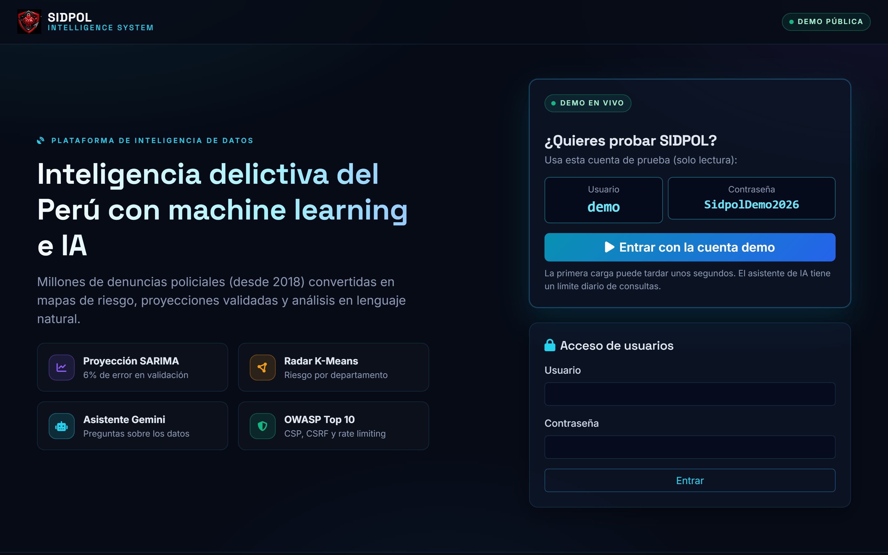
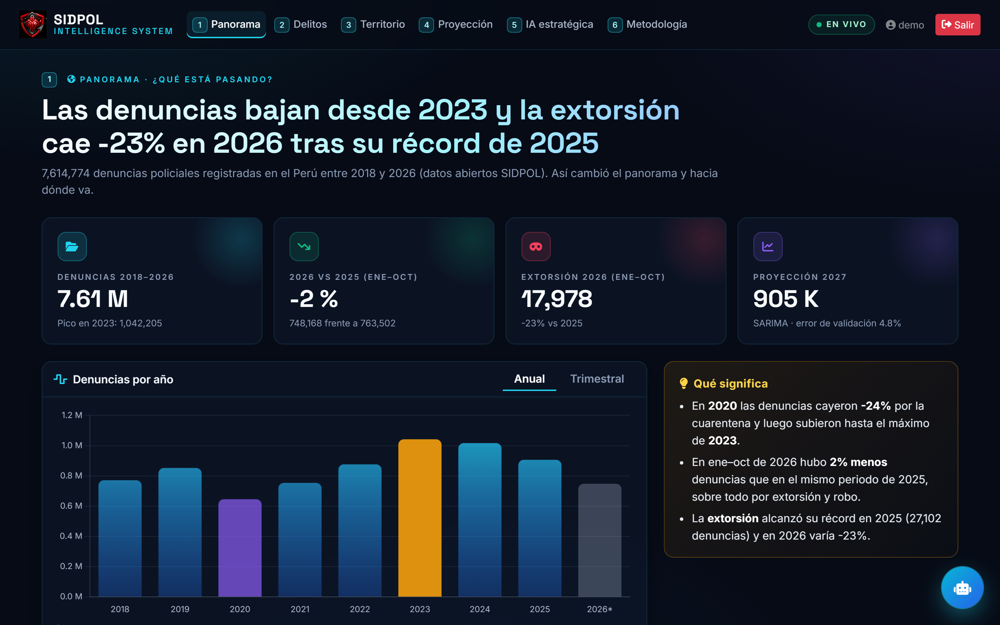

# SIDPOL: Análisis y proyección delictiva en el Perú con Machine Learning e IA generativa

[](https://github.com/Rihuall-star/sidpol-backend/actions/workflows/ci.yml)

Plataforma web de inteligencia de datos sobre las **denuncias policiales del Perú (SIDPOL, enero 2018 – octubre 2026: 7.6 millones de denuncias en 378,187 registros)**. Combina analítica descriptiva, machine learning y un asistente de IA generativa que responde preguntas en lenguaje natural consultando la base de datos.

> Proyecto académico: curso *Tecnologías Emergentes en Inteligencia Artificial*, Maestría en Ingeniería de Sistemas e Informática, Universidad Nacional Mayor de San Marcos (2025).

**🔗 Demo:** https://sidpol-proyecto.onrender.com
**Usuario:** `demo` · **Contraseña:** `SidpolDemo2026`

> Cuenta de solo lectura con un límite diario de consultas a la IA. El servidor gratuito puede tardar unos 30 segundos en despertar la primera vez.



| Dashboard | Radar de riesgo (K-Means) | Proyección |
|---|---|---|
|  |  |  |

---

## 🧭 Cómo está organizada

La aplicación cuenta una historia en 6 secciones. Cada una responde una pregunta, con un titular que es el hallazgo, un gráfico principal, un bloque «Qué significa» y un enlace a la siguiente:

| # | Sección | Pregunta |
|---|---|---|
| 1 | Panorama | ¿Qué está pasando? |
| 2 | Delitos | ¿Qué delitos crecen y cuáles bajan? |
| 3 | Territorio | ¿Dónde ocurre? (distritos, mapa, tasa por habitante, niveles de riesgo) |
| 4 | Proyección | ¿Qué viene el próximo año? (SARIMA + simulador) |
| 5 | IA estratégica | ¿Qué se puede hacer? |
| 6 | Metodología | ¿Por qué creerle a los datos? |

## ✨ Funcionalidades

| Módulo | Qué hace |
|---|---|
| **ETL y calidad de datos** | Une los CSV anuales, acepta las columnas de todas las versiones publicadas (`ANIO`/`MES` y `ANIO_REGISTRO`/`MES_REGISTRO`), valida tipos y rangos, agrega trimestres y suma el campo `cantidad` en lugar de contar filas. Cada carga queda registrada con su fecha de corte. |
| **Clustering K-Means** | Agrupa los departamentos por su volumen total de denuncias en 3 niveles de riesgo: bajo, medio y crítico. |
| **Análisis trimestral** | Compara la evolución de la extorsión con otro delito grave (secuestro u homicidio, según la versión del dataset) con el *Aggregation Framework* de MongoDB. |
| **Análisis regional y per cápita** | Distribución por Costa, Sierra y Selva, y tasas ajustadas por población. |
| **Proyección anual** | Modelo **SARIMA(0,1,1)(0,1,1)₁₂** con intervención COVID-19 que estima el cierre del año en curso y el año siguiente. Validado con los últimos 12 meses reales (**MAPE 4.8%** frente a 15.7% de una regresión lineal), con intervalos de confianza por simulación. Se reentrena con cada versión de los datos. |
| **Asistente con herramientas (Gemini)** | *Function calling*: el modelo elige entre 6 herramientas de datos de solo lectura (ranking, comparación de años, focos distritales, proyección…), la aplicación las ejecuta sobre MongoDB y el modelo responde con esas cifras. El chat muestra qué herramientas usó. |
| **Agentes** | Un *agente estratégico* genera un plan de acción a partir de la proyección y un *analista táctico* comenta la estimación del simulador (Random Forest por departamento y trimestre). |
| **Mapas de calor** | Visualización geoespacial de las zonas críticas (Highcharts Maps). |
| **Autenticación y roles** | Login con Flask-Login, contraseñas con hash (Werkzeug), rutas de administración y auditoría protegidas por rol, y límite diario de consultas a la IA para la cuenta demo. |

## 📊 Hallazgos principales
> Datos hasta **octubre de 2026** (versión publicada el 9 de noviembre de 2026). Los años 2018–2025 están cerrados.

- **Cambio de tendencia:** las denuncias alcanzaron su máximo en 2023 (1,042,205), bajaron 11% en 2025 (906,527) y en ene–oct de 2026 van 2% por debajo del mismo periodo de 2025. SARIMA estima un **cierre de 2026 de ~895 mil** y **~905 mil para 2027** (IC 95%: 703 mil – 1.11 millones).
- **Extorsión:** pasó de 4,352 denuncias en 2021 a su **récord de 27,102 en 2025 (+523%)**. En ene–oct de 2026 **cae 23%**.
- **Concentración de la extorsión:** el 50% de los casos de 2025 ocurrió en solo **20 de 656 distritos** (Cercado de Lima, San Juan de Lurigancho, Trujillo, Sullana…), y esos focos crecieron entre +500% y +1,500% desde 2021.
- **Estafa:** creció **+342%** entre 2018 y 2025.
- **Violencia contra la mujer:** es el delito más denunciado en **21 de 26 departamentos** (sin contar «otros»).
- **Lima Metropolitana** queda sola en el cluster de riesgo crítico (35% de todas las denuncias); Arequipa, Lambayeque, La Libertad y Piura encabezan el nivel medio.
- **La Costa concentra el 75%** de las denuncias del país (5.7 de 7.6 millones).
- **Registro tardío (lección del proyecto):** la proyección hecha con la versión anterior (datos hasta octubre de 2025) esperaba 565 mil denuncias entre enero y octubre de 2026; hubo **748 mil (error de −24%)**. Los últimos meses de esa versión aparecían hasta un 20% más bajos porque aún no se habían registrado todas las denuncias, y el modelo lo leyó como una caída. Entre versiones, además, los años 2018–2024 variaron menos de 1% y varias denuncias cambiaron de modalidad (desapareció «Homicidio» y apareció «Secuestro»).

## 🏗️ Arquitectura



> Diagrama animado: las líneas muestran el recorrido de los datos. Fuente editable en [`docs/arquitectura.drawio`](docs/arquitectura.drawio) (se abre en [diagrams.net](https://app.diagrams.net)).

**Decisiones de diseño**
- **Capas:** las rutas (blueprints) no tocan MongoDB; piden datos a los servicios, y solo el repositorio conoce las colecciones. Todo se prueba con una base en memoria.
- **Precálculo (batch):** SARIMA, K-Means y los hallazgos se calculan una vez por carga de datos y se guardan en `resultados`, con la versión del dataset y la del cálculo. Una visita lee un documento en lugar de agregar 337 mil registros, y el resultado sobrevive a los reinicios del servidor gratuito.
- **Capa gold:** `gold_mensual` agrega por año, mes, departamento y modalidad, con los mismos nombres de campo que los datos crudos. El análisis por distrito sigue usando los crudos.
- **IA con herramientas:** en lugar de enviar siempre el mismo contexto, Gemini pide los datos que necesita mediante *function calling*. Las herramientas son de solo lectura, con parámetros validados contra listas cerradas y un máximo de 2 rondas por pregunta.

| Capa | Tecnología |
|---|---|
| Datos | MongoDB Atlas (PyMongo, Aggregation Framework, índices, TTL) |
| Backend | Python 3.11, Flask (app factory + blueprints), Flask-Login, Gunicorn |
| ML | scikit-learn (K-Means, Random Forest), statsmodels (SARIMA), Pandas, NumPy |
| IA generativa | Google Gemini (SDK `google-genai`, function calling) |
| Frontend | Jinja2, Bootstrap 5, Chart.js, Highcharts Maps |
| Operación | Docker, `/health`, logs JSON con `X-Request-ID`, Render |
| Calidad y seguridad | pytest, mongomock, GitHub Actions, pip-audit, CodeQL, Dependabot |

## 📁 Estructura

```
app.py                     # Punto de entrada WSGI (gunicorn app:app)
sidpol/
  __init__.py              # create_app(): configuración, extensiones y blueprints
  config.py                # Configuración desde variables de entorno
  repositorio.py           # Único acceso a MongoDB
  seguridad.py             # CSP con nonce, cabeceras, roles, redirecciones seguras
  registro.py              # Logs JSON con identificador por petición
  precalculo.py            # Job batch: índices, capa gold y resultados
  blueprints/              # auth · secciones · ia · admin · salud
  servicios/
    analitica.py           # Panorama, Delitos, Territorio (hallazgos desde los datos)
    modelos.py             # SARIMA, K-Means, mapa y simulador Random Forest
    resultados.py          # Resultados precalculados por versión del dataset
    ia.py                  # Gemini: chat con herramientas, agentes, cuota y caché
    herramientas.py        # Herramientas de datos para function calling
etl_carga_mongo.py         # CSV → validación → MongoDB → precálculo
templates/  static/        # Interfaz web
tests/                     # 71 pruebas (pytest + mongomock, sin red)
Dockerfile  docker-compose.yml  .github/
```

## 🔐 Seguridad

La aplicación aplica controles alineados con **OWASP Top 10 (2021)**:

| Riesgo OWASP | Control implementado |
|---|---|
| **A01** Pérdida de control de acceso | Roles (`admin` / `analista` / `invitado`) con decoradores `login_required` y `admin_required`; auditoría y gestión de usuarios solo para administradores. Protección **CSRF** (Flask-WTF) en todos los formularios y en el chat. |
| **A02** Fallas criptográficas | Contraseñas con hash (Werkzeug, PBKDF2/scrypt); HTTPS con **HSTS**; cookies `Secure` en producción. |
| **A03** Inyección / XSS | Consultas a MongoDB con parámetros tipados; escape de HTML en las respuestas del chat antes de insertarlas en la página; plantillas Jinja2 con autoescape. |
| **A04** Diseño inseguro | Cuenta demo de solo lectura con **límite diario de consultas a la IA**, guardado en la base de datos. |
| **A05** Configuración incorrecta | **CSP con nonce por petición** (sin `'unsafe-inline'` en `script-src` y sin JavaScript en línea en las plantillas), `X-Frame-Options: DENY`, `X-Content-Type-Options`, `Referrer-Policy` y `Permissions-Policy`; secretos solo por variables de entorno (la app no arranca sin `SECRET_KEY`); contenedor con usuario sin privilegios. |
| **A06** Componentes vulnerables | Dependencias mínimas y con versión fija; **pip-audit** en cada push (CI) y **Dependabot** semanal; análisis estático con **CodeQL**; **secret scanning + push protection** en GitHub. |
| **A07** Fallas de autenticación | **Rate limiting** en el login (5 intentos por minuto y 30 por hora por IP); sesión nueva en cada login (contra la fijación de sesión); cookies `HttpOnly` y `SameSite=Lax`; expiración de la sesión a las 8 horas. |
| **LLM01** Prompt injection (OWASP Top 10 para LLM) | Reglas del asistente enviadas como *system instruction*, separadas de la pregunta del usuario; prompt limitado a 500 caracteres; respuestas basadas solo en los datos entregados. |
| **LLM06** Agencia excesiva | El modelo no escribe consultas: solo elige entre 6 herramientas de **solo lectura**, con parámetros validados contra listas cerradas (modalidades, departamentos, años), resultados limitados a 15 filas y un máximo de 2 rondas. Cada uso de herramienta queda en el log. |
| **A09** Fallas de registro y monitoreo | Auditoría de inicios de sesión **y de intentos fallidos**, con la IP real del visitante (`ProxyFix`); logs **JSON** con `X-Request-ID` en cada respuesta, listos para un SIEM; endpoint `/health`. |

**Pruebas automatizadas:** 71 pruebas con `pytest` (seguridad, CSP, herramientas de IA, capa gold, resultados precalculados, modelos y secciones) se ejecutan en **GitHub Actions** en cada push, sin conexión a internet, junto con `pip-audit` y un build de la imagen Docker que arranca con MongoDB y responde `/health`.

## 🚀 Ejecución local

```bash
git clone https://github.com/Rihuall-star/sidpol-backend.git
cd sidpol-backend
python -m venv venv
source venv/bin/activate      # En Windows: venv\Scripts\activate
pip install -r requirements.txt
```

Crea un archivo `.env` (está excluido en `.gitignore`):

```env
MONGO_URI=mongodb://localhost:27017/
GEMINI_API_KEY=tu_api_key
SECRET_KEY=una_cadena_larga_y_aleatoria
# Opcionales
GEMINI_MODEL=gemini-3.5-flash
LIMITE_IA_INVITADO=30
```

Carga los datos (incluye el precálculo) y levanta la aplicación:

```bash
python etl_carga_mongo.py denuncias_sidpol.csv
flask --app app run
```

Si los datos ya están cargados y solo cambió el código, basta con recalcular:

```bash
python -m sidpol.precalculo
```

Con Docker (MongoDB local incluido):

```bash
docker compose up -d --build
docker compose run --rm etl
# http://localhost:8000  ·  estado: http://localhost:8000/health
```

Pruebas (usan una base en memoria, no tocan MongoDB ni Gemini):

```bash
pip install -r requirements-dev.txt
pytest tests -v
```

## ⚠️ Limitaciones y trabajo futuro
- La proyección SARIMA asume que la tendencia reciente continúa; ante cambios de política o de registro, el intervalo de confianza es la referencia. Como siguiente paso se plantea comparar con modelos por modalidad y departamento.
- El análisis es a nivel de **departamento**. Para bajar a distrito o cuadrante se necesitaría georreferenciar cada denuncia.
- Las proyecciones son **exploratorias** y con fines académicos, no pronósticos oficiales.

## 📄 Fuente de datos
Dataset abierto de denuncias policiales (SIDPOL), publicado en la Plataforma Nacional de Datos Abiertos del Perú. (datosabiertos.gob.pe).

## 👤 Autor
**Ricardo Huamaní Allcca**: Ingeniero de Redes y Ciberseguridad, maestrando en la UNMSM.
[LinkedIn](https://www.linkedin.com/in/ricardo-huamani-allcca) · [ORCID](https://orcid.org/0000-0002-1214-2917)
